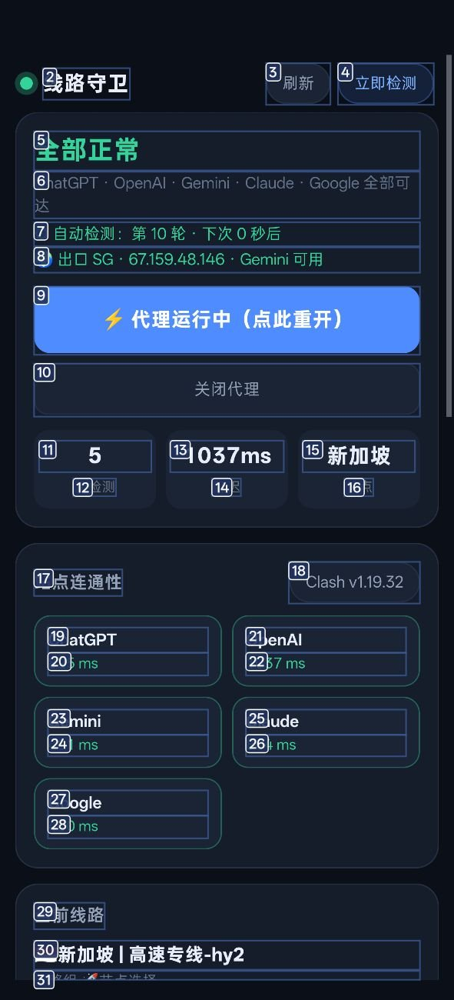

# 线路守卫 · FlClash Guard

一个给 [FlClash](https://github.com/chen08209/FlClash) 用的网络守护 App。

**每 6 秒**检测 ChatGPT / OpenAI / Gemini / Claude / Google 是否可达，不通就自动切到最快且真能用的节点。

- 🚀 独立运行，不依赖电脑、不依赖 Node.js
- 🌍 **检测出口地区**，避免"能连上但 Gemini 提示地区不支持"
- 🔋 关掉 Clash 自动退出，零后台耗电
- 📱 Clash 一开就自动关联启动
- 🔍 DNS 泄露检测 + 局域网代理共享



---

## 为什么需要它

用 Clash 的人都遇到过：

- 聊着 ChatGPT 突然断，得手动去切节点
- Gemini 提示"你所在地区不支持"，但节点测速显示是通的
- 睡前挂着，醒来发现节点死了
- 手机电脑都要用，每次都翻设置填代理

这个 App 把这些活都干了。

---

## 功能

### 1. 五站点真实连通性检测

不是 ping，不是看 TCP，而是发真实 HTTP 请求并校验返回：

| 站点 | 探测地址 | 判定为通的条件 |
|---|---|---|
| ChatGPT | `chatgpt.com/backend-api/me` | 401 / 200 |
| OpenAI | `api.openai.com/v1/models` | 401 / 200 |
| Gemini | `gemini.google.com/generate_204` | 204 **且** 地区支持 |
| Claude | `claude.ai/login` | 200 / 302 / 403+`cf-mitigated: challenge` |
| Google | `gstatic.com/generate_204` | 204 |

> **Claude 那行特别说明**：它的登录页挂在 Cloudflare 人机验证后面，任何脚本（包括 curl）都会拿到
> `403 Just a moment...`。这其实说明"线路通、站点在"，所以按"能连上云"判定，不当成断线。

### 2. 出口地区检测（解决 Gemini 假阳性）

Gemini 的地区限制看的是**出口 IP 归属地**。所以每轮检测都会查一次：

```
https://1.1.1.1/cdn-cgi/trace  →  ip=1.2.3.4  loc=SG
```

不在官方[支持列表](https://support.google.com/gemini/answer/13575153)里的地区（CN / RU / IR / KP 等），
Gemini 直接判为不通，触发切换。

### 3. 全节点扫描，通的挂的都显示

- 递归展开嵌套策略组（`🚀节点选择 → 🇺🇸美国节点 → 具体节点`）
- 自动剔除机场的"信息伪节点"（剩余流量：499 GB、套餐到期：…）
- **12 个并发测速，不通的节点照样列出来标红**，不隐藏

### 4. 自动择优切换

- 只在用户勾选的节点里选（不勾 = 全部）
- 二次验证：不只看延迟数字，还要真实请求一次确认能通
- 失败节点冷却 45 秒，不会每轮都撞同一堵墙
- 全部挂了随机轮换续命

### 5. 自启动 / 关联启动 / 自动退出

| 事件 | 行为 |
|---|---|
| 手机开机 | 自动启动（`BootReceiver` + `JobScheduler` 双保险） |
| FlClash 打开 | 自动关联启动，弹通知 |
| FlClash 关闭 | **进程彻底退出**，零耗电 |
| 被系统杀掉 | `JobScheduler` 叫醒检查 |

### 6. 局域网共享

自动开启 FlClash 的「局域网代理」，App 内直接显示：

```
172.16.30.250:7890
```

并生成二维码，别的设备扫码 → 打开带填写说明的网页 → 复制地址即可。
（服务绑 `0.0.0.0`，开热点换 IP 会自动刷新。）

> ⚠️ **扫码不能自动改对方设备的代理设置** —— iOS / Android 都不允许外部链接修改系统代理。
> 扫码最多做到"省掉手打地址"这一步。

### 7. DNS 泄露检测

判断三种状态：
- `已接管`：所有域名解析成 fake-ip（`198.18.x.x`），不泄露
- `有风险`：解析出真实 IP 但 DNS 未被接管
- `⚠ 泄露`：解析出真实 IP **且**系统 DNS 含国内服务器

---

## 编译

**不需要 Android Studio，也不需要 Gradle。** 纯命令行：

```sh
# 依赖：JDK 8+、Android SDK build-tools、D8 (r8.jar)
export ANDROID_SDK=/path/to/android-sdk
export R8_JAR=/path/to/r8.jar
sh build.sh
# 产物：out/FlClashGuard.apk
```

构建脚本做的六件事：

```
1. aapt2 compile   res/ → out/res.zip
2. aapt2 link      manifest + res → out/base.apk，同时生成 R.java
3. javac           源码 → class
4. D8              class → classes.dex
5. zip             dex 和 assets 塞进 apk（注意保留 assets/ 层级）
6. zipalign+sign   对齐 + 签名
```

### 踩过的坑（写下来省得别人再踩）

**aapt2 版本必须和 android.jar 匹配**
build-tools 29 的 aapt2 读不了 android-35 的资源表（`RES_TABLE_TYPE_TYPE entry offsets overlap`）。
解法：aapt2 用 android-23 打包，javac/D8 用 android-35 的 jar 编译。

**android-23 缺新 API**
`NotificationChannel`、`startForegroundService` 在 android-23 里都没有。
解法同上，双 jar 分离。manifest 里要避开 aapt2 不认识的属性。

**`zip -j` 会压平目录**
WebView 的 `file:///android_asset/index.html` 会变成 404。必须保留 `assets/` 这一层。

---

## 配置

App 内设置页可调：

| 项 | 默认 | 说明 |
|---|---|---|
| 检测间隔 | 6 秒 | 2–30 秒 |
| 延迟告警阈值 | 4000ms | 全通但超过它也去找更快的 |
| 连续失败几次才切 | 2 | 防抖 |
| 失败节点冷却 | 45 秒 | |
| Clash 控制器密钥 | 空 | **必须自己填**，见下 |

### 第一次使用

1. FlClash → **工具 → 常规 → 往下滚到「入站」→ 外部控制器** 打开（端口 9090）
2. 复制那个密钥，填进本 App 的设置页
3. 在「全部节点」里勾选允许切换的节点
4. 点「一键启动代理」

> 首次需要在系统里允许「使用情况访问」权限（用于关联启动检测），App 会引导。

---

## 已知限制

- **不能免 root 做透明代理**：`iptables` 需要 `CAP_NET_ADMIN`，Shizuku 的 shell(2000) 也做不到。实测报 `Permission denied (you must be root)`
- **扫码不能自动设代理**：见上文
- **关联启动依赖使用情况权限**：被系统重置后会退化成"进程存活检测"，响应变慢
- **只支持 FlClash**：其他 Clash 客户端包名不同，需要改 `AppWatcher.CLASH_PKG`

---

## 项目结构

```
GuardApp/
├── src/com/flclashguard/
│   ├── MainActivity.java    界面 + JS 桥
│   ├── WatchService.java    前台服务 / 检测循环
│   ├── Guard.java           检测 + 测速 + 择优 + 地区
│   ├── ClashApi.java        Clash API 客户端（策略组展开、BFS 寻路）
│   ├── AppWatcher.java      前台/进程/VPN 状态检测
│   ├── KeepAliveJob.java    JobScheduler 保活
│   ├── BootReceiver.java    开机自启
│   ├── ClashEventReceiver.java  FlClash 广播监听
│   ├── LanServer.java       局域网说明页（8788）
│   ├── QrCode.java          二维码生成（纯 Java，含 Reed-Solomon）
│   └── App.java             通知 / 设置
├── assets/index.html        前端（原生 HTML，无框架）
├── AndroidManifest.xml
└── build.sh                 纯命令行构建
```

---

## 许可

[MIT](LICENSE)

**请勿用于商业倒卖。** 这个 App 不提供任何节点，节点请自备。

## 免责

仅供学习与个人使用。使用代理请遵守当地法律法规。
